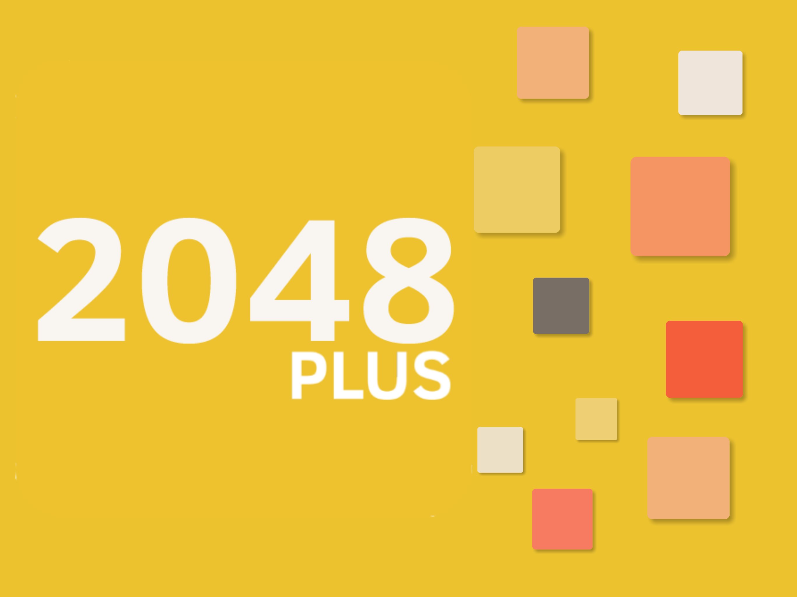

<p align="center">
  
</p>

A feature-packed implementation of the classic puzzle game 2048 for muOS, PortMaster, Linux, and Windows, built using the LÖVE framework.

This project is inspired by and references the popular open-source [2048 Android](https://github.com/tpcstld/2048) game by tpcstld, which itself is based on the original web game by Gabriele Cirulli. While taking visual and design references from the Android version, this codebase was written from the ground up in Lua for the LÖVE engine. In addition to the classic gameplay, I have introduced numerous new features, including multiple game modes, store, an achievement system, and a wide variety of themes to enhance the overall experience.

## Features

- **Game Modes**: Classic, Plus Mode with Bomb, Swap, and Undo powerups, and 4 Arcade Modes — Time Attack, 5x5 Huge, No Mercy, and Goose.
- **Store & Customization**: In-game Store with Coins currency, Cat & Dog pet companions, board skins, unlockable themes, and more.
- **Achievements & Stats**: Many unlockable achievements and comprehensive stats tracking.
- **Jukebox & Wireless Music Manager**: In-game music player with audio visualizer, seeking, shuffle, and a built-in wireless web server to manage, upload, and stream custom music tracks directly from your Phone or PC over Wi-Fi.
- **Quality of Life**: Auto-save & resume after every move, interactive pause menu with active perks HUD, and instant theme switching.

*Note: Perhaps a well-known secret sequence of buttons might reveal something special...?*

## Installation

### muOS
1. Download the latest `.muxapp` file from the [Releases](https://github.com/saitamasahil/2048plus/releases) page or build your own following the [Building from Source](#building-from-source) instructions.
2. Move the downloaded file to the `/mnt/mmc/MUOS/ARCHIVE` folder on your SD card.
3. Open Archive Manager on your device and select the file to install.
4. After installation, you'll find an entry called "2048 Plus" in the Applications section.

### PortMaster
#### Method 1: Direct Install via PortMaster
1. Launch the PortMaster application on your handheld.
2. Go to All Ports or Ready to Run and search for `2048 Plus`.
3. Select Install. The game will automatically download and install into your Ports menu.

#### Method 2: Offline Autoinstall
1. Download the game's `.zip` release package on your PC from [PortMaster](https://portmaster.games/detail.html?name=2048plus) or build your own following the [Building from Source](#building-from-source) instructions.
2. Place the downloaded `.zip` file directly into the `autoinstall` folder on your SD card for your OS:
   - **muOS:** `/mnt/mmc/MUOS/PortMaster/autoinstall/`
   - **ArkOS:** `/roms/tools/PortMaster/autoinstall/`
   - **AmberELEC / ROCKNIX:** `/roms/ports/PortMaster/autoinstall/`
   - **Knulli:** `/userdata/system/.local/share/PortMaster/autoinstall/`
3. Reinsert the SD card into your device and launch the PortMaster app once.
4. PortMaster will automatically detect the `.zip` file and complete the installation.

### Linux
Download `2048_Plus-x86_64.AppImage` from the [Releases](https://github.com/saitamasahil/2048plus/releases) page or build your own following the [Building from Source](https://github.com/saitamasahil/2048plus#building-from-source) instructions. Make it executable (`chmod +x 2048_Plus-x86_64.AppImage`), and run it.

Saves are stored in: `~/.local/share/love/2048plus/`

### Windows
Download and extract `2048_Plus-win64.zip` from the [Releases](https://github.com/saitamasahil/2048plus/releases) page or build your own following the [Building from Source](https://github.com/saitamasahil/2048plus#building-from-source) instructions, then run `2048 Plus.exe`.

Saves are stored in: `%APPDATA%\LOVE\2048plus\`

## Controls

| Action | Gamepad Button | Keyboard Key |
|:---|:---|:---|
| **Move Tiles** | D-Pad / Left Stick | Arrow Keys / WASD |
| **Confirm / Select Item** | `A` | `Enter` |
| **Undo Move / Back / Cancel** | `B` | `Backspace` |
| **Quit to Menu** | `X` | `X` |
| **Cycle Unlocked Themes** | `Y` | `Y` |
| **Activate Swap Powerup** | `L1` | `Q` |
| **Activate Bomb Powerup** | `R1` | `E` |
| **Seek Music** | D-Pad Left / Right | Arrow Left / Right |
| **Show Coin Balance** | `Select` | `Tab/Shift` |
| **Pause Menu / Resume** | `Start` | `Space` |
| **Toggle Fullscreen** | — | `F11` |
| **Force Quit App** | `Menu + Start` | `Alt + F4` |

*Note: Your progress is automatically saved after every move. You can safely close the game and pick up exactly where you left off.*

## Building from Source

To build packages yourself, make sure you are in a Linux environment with `bash`, `zip`, `unzip`, and `curl` or `wget` installed.

### Optional: Windows Icon Patching Requirements
To automatically embed the custom 2048 icon into `2048 Plus.exe` during Windows builds on Linux, the script uses Wine and Python Pillow:
- **Wine**:
  - Debian / Ubuntu: `sudo apt install wine`
  - Arch Linux: `sudo pacman -S wine`
  - Fedora: `sudo dnf install wine`
- **Pillow**:
  - `pip install pillow` or `sudo apt install python3-pil`

If Wine or Pillow is not installed, the Windows package will build with the default LÖVE icon.

### Build Steps

1. Clone this repository:
   ```bash
   git clone https://github.com/saitamasahil/2048plus.git
   cd 2048plus
   ```

2. Make the build script executable:
   ```bash
   chmod +x build.sh
   ```

3. Run the build script:
   ```bash
   ./build.sh
   ```

4. Select your target from the interactive menu (or press **Enter** for All):
   - **`1` (muOS)**: Generates the muOS package in `build/`
   - **`2` (PortMaster)**: Generates the PortMaster package (`2048plus.zip`) in `build/`
   - **`3` (Linux)**: Generates the Linux AppImage in `build/`
   - **`4` (Windows)**: Generates the Windows 64-bit package in `build/`
   - **`5` (All / Default)**: Generates all packages simultaneously

*Note: You can also build non-interactively via CLI arguments: `./build.sh muos`, `./build.sh portmaster`, `./build.sh linux`, `./build.sh windows`, or `./build.sh all`.*

## Credits & Acknowledgements

- Original Concept By: [Gabriele Cirulli](https://github.com/gabrielecirulli/2048)
- Android Port Reference: [tpcstld - 2048](https://github.com/tpcstld/2048)
- Built using the [LÖVE Framework](https://love2d.org/)
- Easter Egg mini-game by: [SLAYKIN6_TTV](https://github.com/justaporter)
- Adorable Animal Sprites by: [Elthen](https://elthen.itch.io/), [Pixelcave](https://pixelcave.itch.io/), and [Duckhive](https://itch.io/profile/duckhive)
- Clock Sprite by: [AlltheturtlesGames](https://itch.io/profile/alltheturtlesgames)
- Arcade Cabinet Sprite by: [bullabit](https://bullabit.itch.io/)
- Skull Sprite by: [NYKNCK](https://itch.io/profile/nyknck)
- Bomb Sprite by: [CazBee](https://itch.io/profile/caz-bee)
- Campfire Sprite by: [Devs In Exile Studio](https://devs-in-exile.itch.io/)
- Animated Button Prompts by: [greenpixels_](https://greenpixels.itch.io/)
- Icons provided by [Flaticon](https://www.flaticon.com/)
- Special Thanks: [Egggdoggo](https://github.com/Egggdoggo) & **d98jay** for early feedback, playtesting & incredible support!
- Background Music tracks provided via [Chosic](https://www.chosic.com/) by authors: AudioCoffee, Ghostrifter Official, Purrple Cat, Roa, Sakura Girl, and Tokyo Music Walker.

---

Made with 💙 by **saitamasahil**
